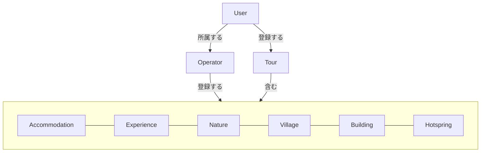

目的：WANDRARA のビジネスモデルと、それに沿ったテーブルの構成を決める。データ構造はこのサービスの中心なので、migration はこの資料が決まってから書く。

# WANDRARA データモデル

状態：実装済み（2026-11-15）。今のマイルストーンで作る範囲。正本はコード（`src/db/schema`）で、この資料は考え方を書く。

## 1. ビジネスモデル



- Tour は、運営者に所属する User も、所属しない User も登録できる
- コア（宿・体験・自然・村・建物・温泉）を登録するのは、運営者に所属する User
- コアは同じ段に並び、どれかが他を含んだり、他に属したりしない。コアどうしは距離（近さ）でつながる
- コアはこれからも増える。増やすときは 3 章の決まりに従う

| モデル | 意味 | 例 |
|---|---|---|
| User | 使う人 | |
| Operator | 宿や体験などを運営する事業者。ログインしない事業者もいる。1 つの事業者に複数の User、1 人の User が複数の事業者に所属できる | |
| Tour | 旅の計画。コアを順に含む | |
| Accommodation | 宿 | ヴィラ キング 熱海 |
| Experience | 体験 | ワイナリー見学、磯遊び |
| Nature | 自然 | 城ヶ崎海岸、芦ノ湖、仙石原高原 |
| Village | 村・町並み（温泉街・宿場町・漁村など） | 修善寺温泉街、箱根湯本 |
| Building | 建物（美術館・神社・寺・城・展望台など） | 箱根神社、修禅寺 |
| Hotspring | 日帰り温泉・外湯 | 修善寺の外湯 |

## 2. テーブル

### 共通の ID
```
destinations          dest_id・core_type（accommodation / experience / nature / village / building / hotspring）・slug・is_demo
```
どのコアも destinations に 1 行を持ち、コアの表の主キーは dest_id。Tour・保存・写真・分類・公開は dest_id を指す。

### 利用者と運営者
```
users                 表示名・ログイン・表示の言語と通貨
operators             事業者名・種別（会社・個人・自治体・団体）・連絡先
operator_memberships  user_id・operator_id（運営者であるかは所属で決まる。掲載を承認できる権限とは別）
user_saves            user_id・dest_id
```

### Tour
```
tours                 名前・説明・登録した User・公開/非公開
├ tour_stops          順番・何日目・メモ・dest_id
└ tour_shares         閲覧だけのリンク
```

### コアと詳細

```
accommodations                 operator_id・種類（ホテル・旅館・一棟貸し・民宿・ペンション・グランピング・キャンプ場）・位置・住所・地域・チェックイン/アウト・公式 URL
├ accommodation_units          部屋タイプか一棟：定員・㎡・畳・和洋・眺望
│ └ accommodation_bedrooms     寝室
│   └ accommodation_beds       寝室ごとの寝具と数（布団を含む）
├ accommodation_baths          大浴場/露天/貸切/客室露天・源泉の扱い・泉質・時間・予約・料金・男女入替（部屋のものは unit を指す）
├ accommodation_meals          朝/夕・場所・時間・アレルギー・自炊
├ accommodation_prices         unit・金額・通貨・人数・食事・期間・税と入湯税と宿泊税と清掃料の込み別・どの予約先で見たか
├ accommodation_amenities      設備（BBQ・キッチン・ペット…）。宿全体か部屋か・有料か
├ accommodation_parkings       駐車場：場所・台数・車高の制限・料金
├ accommodation_internet       Wi-Fi の有無・実測の速さ・机
├ accommodation_rules          静かにする時間・BBQ の時間・最短泊数・喫煙・パーティー・花火・ゴミ
├ accommodation_access         駅・送迎・坂や階段・車が要るか・冬の規制
├ accommodation_surroundings   隣家との距離・視線・騒音源・眺望・標高
├ accommodation_cautions       よくある誤解と注意点
├ accommodation_licenses       旅館業の許可・民泊の届出番号
├ accommodation_booking_links  予約先
└ accommodation_texts          名前・説明（言語ごと）

experiences                    operator_id・種類（ツアー・ワークショップ・試飲・アクティビティ・施設の利用・イベント）・地域・所要時間・要予約・公式 URL
├ experience_courses           内容・時間・人数・年齢・案内の言語
├ experience_prices            course・1 人/1 グループ/1 回・子ども料金・込み別
├ experience_schedules         季節・曜日・時間帯・雨天時の扱い
├ experience_locations         集合場所・実施場所の位置と住所（座標が 1 つとは限らない）
├ experience_inclusions        含まれるもの・含まれないもの・持ち物
├ experience_cautions
├ experience_booking_links
└ experience_texts

natures                        種類（海岸・山・湖・高原・渓谷・滝・森・火山）・位置・地域・保護の区分
├ nature_seasons               見頃（何が・いつ）
├ nature_hours_fees            入れる時間・入場料
├ nature_access                駐車場・最寄り駅・徒歩の時間
├ nature_trails                距離・高低差・難しさ・所要時間
├ nature_restrictions          立入規制・火山ガスの警戒・期間
├ nature_cautions
└ nature_texts

villages                       種類（温泉街・宿場町・漁村・門前町・城下町）・位置・地域
├ village_walks                巡る範囲・所要時間
├ village_shop_hours           店が開いている時間帯
├ village_access               アクセス・駐車場
├ village_events               祭り・イベントと時期
├ village_cautions
└ village_texts

buildings                      operator_id・種類（美術館・博物館・神社・寺・城・展望台・歴史的建造物）・位置・地域・公式 URL
├ building_hours               開いている時間・休みの日
├ building_fees                入館料・拝観料
├ building_access              アクセス・駐車場
├ building_events              企画展・祭事と時期
├ building_cautions
└ building_texts

hotsprings                     operator_id・種類（日帰り温泉・外湯・足湯）・位置・地域・公式 URL
├ hotspring_baths              内湯/露天・源泉の扱い・泉質
├ hotspring_hours              開いている時間・休みの日
├ hotspring_fees               料金（大人・子ども・貸切）
├ hotspring_amenities          タオル・休憩所・食事
├ hotspring_access             アクセス・駐車場
├ hotspring_cautions
└ hotspring_texts
```

### 全コアで共通
```
dest_photos           dest_id・写真・権利・何を写しているか（部屋やコースを指すときは、その dest に属するものに限る）
dest_categories       dest_id・category_id
publications          dest_id・状態・公開日時・承認者
```

### 辞書
```
regions               箱根・伊豆などの範囲（自治体コードも）
categories            分類（親子を持つ）
amenity_codes など     設備・規則のコード（OTA や Google のコードへの対応）（まだ作っていない）
languages・currencies・fx_rates（まだ作っていない）
```

### 投入
```
collector_keys        エージェント用の API キー（User ごと。sha256 だけを持つ・取り消せる）
dest_imports          投入された入力の原本（出典・確認の状態もここに残る）
```

## 3. 決まり
- **コアを増やすとき**：コアの表（主キー dest_id）と、意味のある詳細テーブルを作る。Tour・保存・写真・分類・公開の表は直さない
- **詳細テーブルの分け方**：「別の対象か」「独立して複数行になるか」「更新や確認の単位が違うか」で分ける。関連の薄い列をまとめない
- **項目が無いとき**：NULL。分かっている値は、その型（false・0 など）で持つ
- **公開**：コアの列には持たせず、publications で持つ
- **翻訳**：コアごとの *_texts に、列と型を保ったまま持つ（何でも入る field_name / text の形にしない）
- **近さ**：コアの位置から計算する。テーブルには持たない
- **spot という語は使わない**

### 実装で決めたこと
- **詳細の行の中の文**（注意点・メモなど）は、列ごとに jsonb の LocalizedText（`{"ja": "...", "en": "..."}`）で持つ。名前・紹介・住所は *_texts
- **詳細の表は全部 dest_id を持つ**（入れ子の子も）。消す・入れ直す・RLS の判定を dest_id だけでできる
- **投入**：エージェントは API キー（collector_keys）で `POST /api/{core}` に送り、受け取った入力そのものは dest_imports に残す。登録すると publications は draft になり、管理者が公開する
- **詳細どうしの参照**（unit_id・booking_link_id・course_id など）は、今は入力で受けない（入れ子の親を指す列は、入れ子の位置から入る）
- **ログイン**：メールのリンク（Supabase Auth）。Google は後で（`NEXT_PUBLIC_AUTH_GOOGLE=1` のときだけ出る）

## 4. 次のマイルストーンで検討
- 近さで分からないつながり（宿泊者限定の体験、宿が手配する体験、集合場所など）。案：つながりの持ち主のコアに、相手の dest_id をカラムで持つ。role は使わない
- 出典・根拠：詳細の値の 1 つずつに、複数の出典を付ける仕組み
- 承認した版：公開中の内容を見せながら、新しい内容を審査する仕組み
