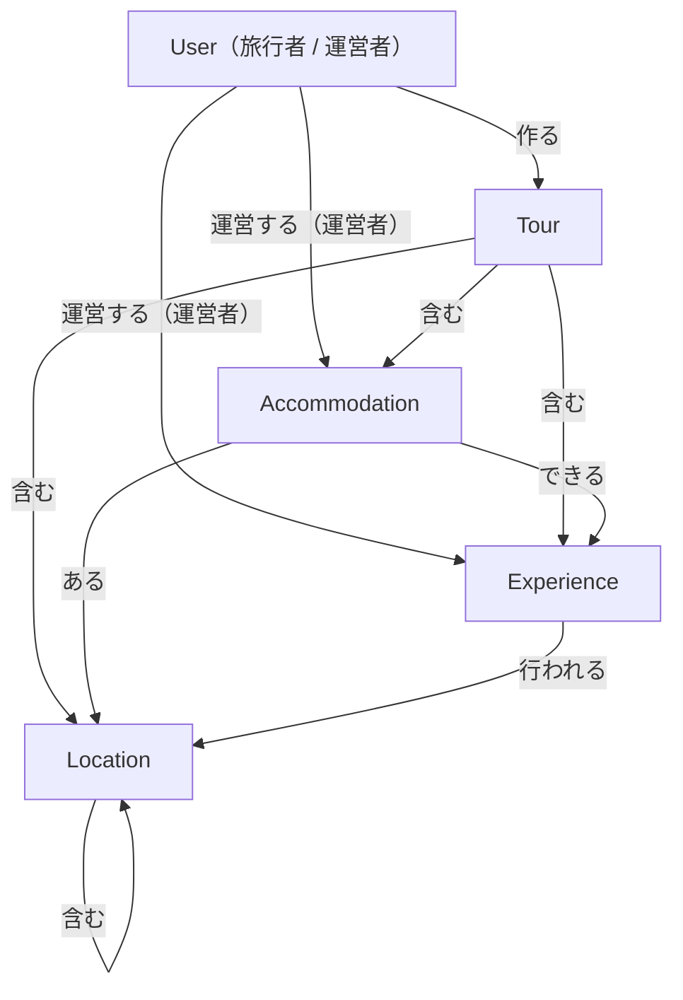

目的：WANDRARA のビジネスモデルを、本体のモデルとその関係だけで表す。各モデルに属する項目（分類・写真・事実など）は、この関係が決まってから書く。

# WANDRARA ビジネスモデル

状態：案（2026-11-15）

| モデル | 意味 |
|---|---|
| User | 使う人。旅行者として Tour を作る。運営者なら宿・体験を運営する |
| Tour | User が作る旅の計画。宿・体験・場所を順に含む |
| Accommodation | 宿 |
| Experience | 体験 |
| Location | 場所。地域も見どころも含み、場所が場所を含む |
