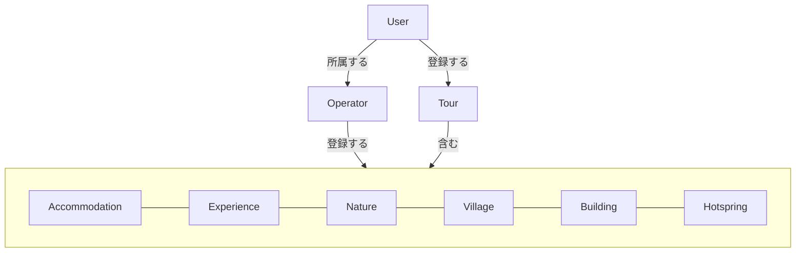

目的：WANDRARA のビジネスモデルと、それに沿ったテーブルの構成を決める。データ構造はこのサービスの中心なので、migration はこの資料が決まってから書く。

# WANDRARA データモデル

状態：改訂案（2026-11-15）。詳細の表をコアごとの型つき JSON（details）にまとめる案。今の実装は詳細を表で持っている（移行は 5 章）。正本はコード（`src/db/schema` と details の zod）で、この資料は考え方を書く。

## 1. ビジネスモデル



- Tour は、運営者に所属する User も、所属しない User も登録できる
- コア（宿・体験・自然・村・建物・温泉）を登録するのは、運営者に所属する User
- コアは同じ段に並び、どれかが他を含んだり、他に属したりしない。コアどうしは距離（近さ）でつながる
- コアはこれからも増える。増やすときは 3 章の決まりに従う

| モデル | 意味 | 例 |
|---|---|---|
| User | 使う人 | |
| Operator | 宿や体験などを運営する事業者。ログインしない事業者もいる。1 つの事業者に複数の User、1 人の User が複数の事業者に所属できる | |
| Tour | 旅の計画。コアを順に含む | |
| Accommodation | 宿 | ヴィラ キング 熱海 |
| Experience | 体験 | ワイナリー見学、磯遊び |
| Nature | 自然 | 城ヶ崎海岸、芦ノ湖、仙石原高原 |
| Village | 村・町並み（温泉街・宿場町・漁村など） | 修善寺温泉街、箱根湯本 |
| Building | 建物（美術館・神社・寺・城・展望台など） | 箱根神社、修禅寺 |
| Hotspring | 日帰り温泉・外湯 | 修善寺の外湯 |

## 2. テーブル

### 共通の ID
```
destinations          dest_id・core_type（accommodation / experience / nature / village / building / hotspring）・slug・is_demo
```
どのコアも destinations に 1 行を持ち、コアの表の主キーは dest_id。Tour・保存・写真・分類・公開は dest_id を指す。

### 利用者と運営者
```
users                 表示名・ログイン・表示の言語と通貨
operators             事業者名・種別（会社・個人・自治体・団体）・連絡先
operator_memberships  user_id・operator_id（運営者であるかは所属で決まる。掲載を承認できる権限とは別）
user_saves            user_id・dest_id
```

### Tour
```
tours                 名前・説明・登録した User・公開/非公開
├ tour_stops          順番・何日目・メモ・dest_id
└ tour_shares         閲覧だけのリンク
```

### コアと詳細

コアの表には「検索・並び替え・結合に使う列」だけを置き、それ以外の詳細はコアごとの `details`（型つき JSON、jsonb）1 つにまとめる。details の形は core_type ごとの zod で決める。

```
accommodations                 operator_id・種類（ホテル・旅館・一棟貸し・民宿・ペンション・グランピング・キャンプ場）・位置・地域・チェックイン/アウト・公式 URL・details
└ details                      rooms（key・定員・㎡・畳・和洋・眺望・喫煙・寝室と寝具）
                               baths（種類〔サウナを含む〕・温泉か・泉質・時間・男女・予約・料金・水風呂・外気浴）
                               meals（朝/夕・出るか・形式・場所・時間・選べる時刻・料金・アレルギー・自炊）
                               prices（seasons〔key・期間・曜日・祝日・日付〕・items〔種類・単位・room と season の key・人数・対象と年齢・割合・含むもの〕）
                               amenities（語彙の code・付いているもの・数・有料か）・internet（上り/下り・測った日・机）
                               pets・rules・parking・access（手段と時間・送迎・坂）・surroundings・cautions・licenses・booking_links・sources

experiences                    operator_id・種類・地域・所要時間・要予約・公式 URL・details
└ details                      courses（key）・prices（course の key）・schedules・locations（座標が 1 つとは限らない）・inclusions・cautions・booking_links・sources

natures                        種類・位置・地域・保護の区分・details
└ details                      seasons・hours・fees・access・trails・restrictions・cautions・sources

villages                       種類・位置・地域・details
└ details                      walks・shop_hours・access・events・cautions・sources

buildings                      operator_id・種類・位置・地域・公式 URL・details
└ details                      hours・fees・access・events・cautions・sources

hotsprings                     operator_id・種類・位置・地域・公式 URL・details
└ details                      baths・hours・fees・amenities・access・cautions・sources

*_texts                        名前・紹介・住所（言語ごと。名前で検索するので表のまま）
```

- 検索や並び替えに使う値は、details から列に出す（例：宿の料金の最小・最大で並べるなら、取り込みのときに列にも書く）。出した列の正は details
- 料金の区分ごとの値も details に型で持つ。画面には出さない（不正確だとクレームの元）
- 詳細の中の参照（料金→部屋・料金→区分・写真→部屋）は dest の中の key で指す。id は使わない

### 全コアで共通
```
dest_photos           dest_id・写真・何を写しているか（部屋やコースは details の key で指す）
dest_categories       dest_id・category_id
publications          dest_id・状態・公開日時・承認者
```

### 辞書
```
regions               箱根・伊豆などの範囲（自治体コードも）
categories            分類（親子を持つ）
語彙                   設備（中カテゴリ → 小カテゴリの 2 段）・風呂の種類・料金の種類など。表にせず、コードに一覧を 1 つ置く。details の zod・表示名・OTA や Google のコードへの対応が同じ一覧を見る
languages・currencies・fx_rates（まだ作っていない）
```

### 投入
```
collector_keys        エージェント用の API キー（User ごと。sha256 だけを持つ・取り消せる）
dest_imports          投入された入力の原本（出典・確認の状態もここに残る）
```

## 3. 決まり
- **コアを増やすとき**：コアの表（主キー dest_id）と details の zod を作る。Tour・保存・写真・分類・公開の表は直さない
- **表にするか details にするか**：次のどれかに当たるものだけを表（または列）にする。それ以外は details
  - ほかの dest や機能から指される（destinations・写真・分類・公開・Tour）
  - dest をまたいで検索・並び替え・結合する（種類・地域・位置・チェックイン/アウト など）
  - ファイルや外の仕組みとつながる（写真と Storage）
- **details の形**：core_type ごとの zod で決め、書き込む前に必ず確かめる。値の種類は語彙の一覧から選ぶ。DB 側でも JSON Schema（Supabase の pg_jsonschema）で確かめる（使えるかは確かめてから決める）
- **形を変えるとき**：zod を直し、投入の原本（dest_imports）から作り直す。migration は表の列を変えるときだけ
- **項目が無いとき**：欄を書かない（JSON にキーが無い）。分かっている値は、その型（false・0 など）で持つ
- **公開**：コアの列には持たせず、publications で持つ
- **翻訳**：名前・紹介・住所はコアごとの *_texts に、列と型を保ったまま持つ。details の中の文（注意点・メモなど）は LocalizedText（`{"ja": "...", "en": "..."}`）
- **何でも入る形にしない**：field_name / text の形（EAV）にはしない。details は欄と型が zod で決まっているので、これに当たらない
- **近さ**：コアの位置から計算する。テーブルには持たない
- **spot という語は使わない**

### 実装で決めたこと
- **投入**：エージェントは API キー（collector_keys）で `POST /api/{core}` に送り、受け取った入力そのものは dest_imports に残す。登録すると publications は draft になり、管理者が公開する
- **ログイン**：メールのリンク（Supabase Auth）。Google は後で（`NEXT_PUBLIC_AUTH_GOOGLE=1` のときだけ出る）

## 4. 次のマイルストーンで検討
- 近さで分からないつながり（宿泊者限定の体験、宿が手配する体験、集合場所など）。案：つながりの持ち主のコアに、相手の dest_id をカラムで持つ。role は使わない
- 出典・根拠：details の sources に、どの項目の出典かを持つ（fields）。値の 1 つずつに付けるかは後で決める
- 承認した版：公開中の内容を見せながら、新しい内容を審査する仕組み

## 5. 移行（詳細の表 → details）

なぜ変えるか
| | 詳細を表に分ける（今） | details（型つき JSON） |
|---|---|---|
| 形を変えるとき | 毎回 migration | zod を直し、原本から作り直す |
| 詳細どうしの参照 | 外部キーが要り、今の取り込みでは受けられない | dest の中の key で指す |
| 値の正しさ | DB の CHECK・外部キー | 書き込み前の zod（DB でも JSON Schema で確かめられる） |
| dest をまたぐ検索 | SQL で素直に書ける | よく使う条件は列に出す。それ以外は JSON の検索と GIN 索引 |
| 書き込み | 表ごとに消して入れ直す | dest ごとに 1 つ置き換える（コレクターは毎回全部を送るので合う） |
| 公開の権限（RLS） | 詳細の表すべてに要る | コアの行だけ |
| 人が DB を直接見る・直す | 見やすい | JSON を読む（直接直すのは不向き） |

今変える理由：beta 前で本番は開発環境として扱える。投入の原本が dest_imports に全部残っていて作り直せる。投入の作り直し（handoff ingest-pipeline）の structure の段の書き込み先をこの形にすれば、二度作らずに済む

手順
1. 宿だけで移す：accommodations に details を足し、zod・取り込み（plan・apply）・画面用の型（docs/proposals/web-output-model-spec.html の 2 章）・詳細の画面を直す。wr-ito-033 で確かめる
2. 原本から宿の details を作り直すスクリプトで、全部の宿を移す。移ったら宿の詳細の表を消す
3. 残りの 5 種類を同じ形で移す
4. collector-guide・agent-upload-guide の送り方を直す

未決
- pg_jsonschema を使うか（Supabase で使えるか、zod から JSON Schema を作れるか）
- 料金の最小・最大など、どの値を列に出すか（画面の並び替え・絞り込みで決める）
- 体験の locations（座標が複数）を details に入れたとき、近さの計算をどうするか

