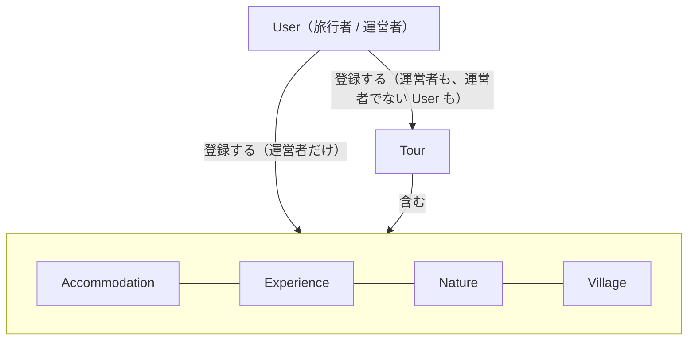

目的：WANDRARA のビジネスモデルを、本体のモデルとその関係だけで表す。各モデルに属する項目（分類・写真・事実など）は、この関係が決まってから書く。

# WANDRARA ビジネスモデル

状態：案（2026-11-15）

- Accommodation・Experience・Nature・Village を登録するのは運営者
- Tour は、運営者も運営者でない User も登録できる

- Accommodation・Experience・Nature・Village は同じ段に並び、どれかが他を含んだり、他に属したりしない
- 同じ段どうしは、距離（近さ）でつながる

| モデル | 意味 |
|---|---|
| User | 使う人。運営者（operator = true）と、運営者でない User（operator = false）がいる |
| Tour | 旅の計画。宿・体験・自然・村を順に含む。運営者も運営者でない User も登録する |
| Accommodation | 宿 |
| Experience | 体験 |
| Nature | 自然。海岸・山・湖・高原・渓谷など（城ヶ崎海岸、芦ノ湖、仙石原高原） |
| Village | 村。人が暮らし、歩いて巡る町並み。温泉街・宿場町・漁村など（修善寺温泉街、箱根湯本） |
