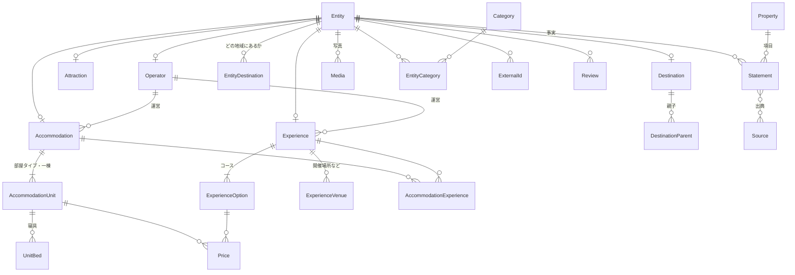
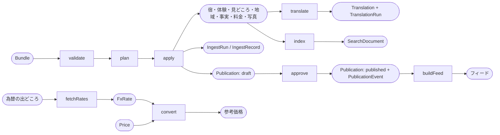

目的：WANDRARA に必要なデータモデル（DataClass）と、それを作り・変える処理（矢印）を分けて書き出し、表を作る前に決める。データ構造はこのサービスの中心なので、migration はこの資料が決まってから書く。

# WANDRARA データモデルと処理

状態：案（2026-11-15）。DataClass と主なフィールド、処理の Input → Output まで。型・索引・RLS は次の段階で詰める。

## 1. 前提

### ビジネスモデル（PRD より）
- 写真から、地域・宿・体験を見つけるディスカバリーのサービス。予約や販売はしない（ベータ）
- 見つけ方は 2 方向：地域 → そこでできる体験、体験 → それができる地域
- 差別化は「細かく、出典があり、新しい事実」。不明は不明と出し、レビューは誰かの意見として出す
- 最初に厚くするのは宿、次に体験
- 後で：AI が作るパッケージ、物産やパートナー商品の販売、現地取材

### 原則
1. **モデルと処理を分ける**。モデルは DataClass（データの形だけ）、処理は矢印（`Input → 処理 → Output`）で書く。DataClass は自分を作った処理や、処理の途中の状態を持たない
2. **処理の状態は、処理が出す DataClass にする**。例：公開の状態は宿や体験の列ではなく、承認の処理が出す Publication
3. **ビジネスの言葉で分ける**。「spot」のような何でも入る言葉は使わない
4. **宿と体験は同列**。どちらも「本体 → 単位 → 料金」の同じ形で、どちらかがもう一方の下にぶら下がらない
5. **共通の仕組みは共通の ID（Entity）に付ける**。事実・写真・カテゴリ・外部 ID・保存・My Tour は、宿・体験・見どころ・地域に同じ形で付く
6. **事実は値と出典を一緒に持つ**（Wikidata の statement の形）。項目は定義（Property）で型を決める
7. **不明と「無い」を分ける**。値が無いことと、無いと確かめたことは別
8. **言語は増える**。名前・説明は本体に持たず、Translation に持つ
9. **外部の標準に対応づける**。自前のコードを正とし、観光庁・OTA・Google・OSM などへの対応を持つ

## 2. データモデル（DataClass）

### 2.1 全体図（内容と信頼）

### 2.2 用語

| 言葉 | DataClass | 意味 | 例 |
|---|---|---|---|
| 共通の ID | Entity | 宿・体験・見どころ・地域・運営者に共通の ID | |
| 地域 | Destination | 観光地としての地域。親子の階層を持ち、親は複数でもよい | 箱根、仙石原、伊豆、伊東 |
| 見どころ | Attraction | 行って見る・歩く対象。宿でも体験でもない | 城ヶ崎海岸、大涌谷 |
| 宿 | Accommodation | 泊まれる施設 | ヴィラ キング 熱海 |
| 宿の単位 | AccommodationUnit | 料金と定員の単位。部屋タイプか、一棟貸しの一棟 | 和室 10 畳、一棟（最大 10 名） |
| 体験 | Experience | すること | ワイナリー見学、磯遊び |
| 体験のコース | ExperienceOption | 料金と所要時間の単位 | 90 分コース |
| 運営者 | Operator | 宿や体験を運営する事業者 | |
| 事実 | Statement | ある対象についての、出典つきの 1 つの主張 | 「駐車場：3 台」出典 公式サイト |
| 項目 | Property | 事実の項目の定義（型・単位・付けられる対象） | parking_spaces（整数、台） |
| 出典 | Source | 事実の根拠 | 公式サイトの URL と取得日 |
| 写真 | Media | 権利情報つきの画像 | |
| カテゴリ | Category | 自前の分類。階層を持ち、多対多で付く | 温泉 ＞ 貸切風呂 |

区分：**β** ベータで使う／**後** 後で足す（形だけ決める）

### 2.3 内容

**Entity**（β）
- id、type（destination / attraction / accommodation / experience / operator）、slug
- is_demo（デモの内容か）

**Destination**（β）：地域
- id（= Entity.id）、level（region / municipality / district / area）
- geo（代表地点。後で範囲）、municipality_code（全国地方公共団体コード 6 桁）

**DestinationParent**（β）：地域の親子。木ではなく DAG（観光エリアは行政区画と重なる）
- child_id、parent_id、kind（administrative / tourism）

**Attraction**（β）：見どころ
- id、attraction_type（nature / onsen_town / shrine_temple / museum / viewpoint / beach など）、geo、address

**EntityDestination**（β）：宿・体験・見どころがどの地域にあるか
- entity_id、destination_id、role（located_in / serves）

**Operator**（β）：運営者
- id、legal_name、kind（company / individual / municipality / association）、website

**Accommodation**（β）：宿
- id、operator_id、accommodation_type（hotel / ryokan / vacation_rental / minshuku / pension / hostel / glamping / campground）
- geo、address、check_in_from、check_in_until、check_out_until、official_url

**AccommodationUnit**（β）：部屋タイプか一棟
- id、accommodation_id、unit_type（room_type / whole_property / bed_in_dorm / site）
- max_occupancy、floor_area_m2、tatami_mats、bedrooms、bathrooms、toilets、room_style（japanese / western / japanese_western）、view

**UnitBed**（β）：寝具
- unit_id、bed_type（single / semi_double / double / queen / king / futon / sofa_bed / bunk）、count

**Experience**（β）：体験
- id、operator_id、experience_type（tour / workshop / tasting / activity / facility_use / event）
- duration_min_from、duration_min_to、booking_required、official_url

**ExperienceOption**（β）：コース。1 つだけなら default を 1 つ置く
- id、experience_id、is_default、duration_min_from、duration_min_to
- min_participants、max_participants、min_age、languages

**ExperienceVenue**（β）：体験がどこで行われるか
- experience_id、venue_id（宿・見どころ・地域の Entity）
- role（held_at / meeting_point / start / end / admission_included / related）

**AccommodationExperience**（β）：宿と体験の対等な関係
- accommodation_id、experience_id、relation（on_site / offered_by_property / partner）

**Price**（β）：料金の観測。AccommodationUnit か ExperienceOption のどちらか一方に付く
- id、accommodation_unit_id か experience_option_id
- amount、amount_max、currency（ISO 4217）、is_from（「〜から」の目安）
- basis（per_person / per_unit / per_group / per_booking）、period（per_night / per_stay / per_session）
- guests、nights、meal_plan（room_only / breakfast / half_board＝1 泊 2 食 / full_board）
- valid_from、valid_to、conditions（曜日・季節）
- tax / service_charge / bathing_tax（入湯税）/ accommodation_tax（宿泊税）/ cleaning_fee：それぞれ included / excluded / not_applicable / unknown
- checked_at、sources（Source への参照）

**Media**（β）：写真
- id、entity_id、subject_unit_id / subject_option_id（任意。どの部屋・コースの写真か）
- storage_key、width、height、sort、is_hero
- license、creator、credit_text、copyright_holder、acquire_license_url
- source_page_url、original_url、retrieved_at、rights_checked_at、digital_source_type（撮影 / AI 生成など）

**Category**（β）：id、icon、sort。**CategoryParent**：child_id、parent_id。**EntityCategory**：entity_id、category_id、is_primary

**ExternalId**（β）：entity_id、scheme（google_place / osm / wikidata / municipality_code / rakuten_travel / jalan / booking / airbnb / collector）、value、url。(scheme, value) は一意

**Review**（β・読み取りのみ）：外部のレビューの抜き出し
- id、entity_id、source_id、author_display、language、posted_at、excerpt、original_url、rights_checked_at
- 元の点数があるときだけ rating と scale。数や平均を作らない

**Translation**（β）：言語ごとに変わる文字列。対象ごとに 1 つ（AccommodationTranslation など）
- 対象の id、language、各文字列（name、summary、description、alt など）
- origin（source / machine / human）：画面で「機械翻訳」と示すため

**Language**（β）：BCP 47 のコード、表示名、有効か、フォールバック先、並び順

**Currency**（β）：ISO 4217、表示名、小数の桁

### 2.4 信頼（事実と出典）

**Property**（β）：項目の定義
- code、datatype（boolean / integer / decimal / text / enum / time_range / url）、unit、applies_to、group（設備 / 規則 / アクセス / 制限）

**PropertyOption**（β）：enum の選択肢。property_code、code、sort

**PropertyMapping**（β）：外部の標準への対応。property_code、scheme（ota_hac / ota_rma / google_lodging / google_vr / schema_org / osm / mlit_dataset）、external_code

**Statement**（β）：事実
- id、entity_id（単位やコースに付くときは subject_unit_id / subject_option_id）、property_code
- value_kind（value / unknown / none）：none は「無いと確かめた」
- value、valid_from、valid_to
- rank（preferred / normal / deprecated）：食い違いは行を並べ、正とするものを preferred にする
- verification（unverified / verified / conflict / stale）、checked_at、checked_by
- 確認状態は利用者に見せる「信頼度」なので、処理の状態ではなく事実の一部として持つ

**StatementQualifier**（β）：条件。statement_id、qualifier（season / weekday / fee_required / reservation_required / note）、value

**Source**（β）：出典。id、source_type（official_site / ota / government / onsite_research / phone / document）、url、publisher、retrieved_at、archive_url

**StatementSource**（β）：statement_id、source_id、quote（根拠の抜き出し）

**CategoryMapping**（β）：category_id、scheme（mlit_kanko_5digit / gif_poi / osm_tag / google_ttd / schema_org）、external_code

### 2.5 利用者

**Profile**（β）：user_id（auth.users）、display_name、preferred_language、preferred_currency

**SavedItem**（β）：user_id、entity_id、saved_at

**Tour**（β）：My Tour。id、user_id、name、created_at、updated_at

**TourItem**（β）：tour_id、entity_id（宿・体験・見どころが混ざる）、position、note

**TourShare**（β）：閲覧だけの共有リンク。tour_id、token、created_at、revoked_at

### 2.6 処理が出す DataClass

処理の入力・出力・状態になるデータ。内容（2.3〜2.5）からは参照しない。参照の向きは、いつも処理のデータ → 内容。

**Bundle**（β）：コレクターが集めた原本。JSON Schema（schema/content-bundle.schema.json）で形を決める

**CollectorKey**（β）：エージェント用の API キー。id、name、key_hash、created_at、revoked_at、last_used_at

**IngestRun**（β）：取り込みの 1 回。id、collector_key_id、bundle_hash、dry_run、started_at、finished_at、summary

**IngestRecord**（β）：取り込んだ原本。ingest_run_id、external_ref、entity_id、record、collected_at

**Publication**（β）：公開の状態。entity_id、status（draft / published / withdrawn）、updated_at。1 つの Entity に 1 行

**PublicationEvent**（β）：公開の状態の変更の記録。entity_id、from_status、to_status、actor、reason、at

**TranslationRun**（β）：機械翻訳の記録。対象・言語・model・source_language・source_hash・translated_at

**EditorialRanking**（β）：編集部のおすすめ順。entity_id、rank、updated_at。人気の数の代わりにしない

**SearchDocument**（β）：検索用にまとめた文と埋め込み。entity_id、language、text、embedding、updated_at

**FxRate**（β）：参考の為替。base、quote、rate、as_of、source

### 2.7 後で足すもの（形だけ決める）
- **Package / PackageItem**：AI や編集部が組んだ旅程の商品
- **RatePlan**：宿の「プラン」（食事・特典）。Price を RatePlan にも付けられるようにする
- **Availability / Booking**：空き・予約
- **Product / Offer**：物産・パートナー商品
- **FieldResearchAssignment**：現地取材（結果は Statement と Media に入る）

## 3. 処理（矢印）

### 3.1 全体図

### 3.2 一覧

| 処理 | Input → Output |
|---|---|
| 鍵の発行 | キーの名前 → **issueKey** → CollectorKey と平文のキー（一度だけ） |
| 検証 | 未検証の JSON → **validateBundle** → Bundle ／ スキーマのエラー |
| 計画 | Bundle と既存の Entity・Category → **planImport** → 取り込み計画（作る・変える・消す内容） |
| 写真の配置 | 写真の中身 → **storeMedia** → storage_key と Media |
| 保存 | 取り込み計画 → **applyImport** → 内容の DataClass、IngestRun、IngestRecord、Publication（draft） |
| 翻訳 | 原文の Translation → **translate**（モデルは差し替え可）→ 訳の Translation（origin = machine）と TranslationRun。source_hash がずれたものだけ訳し直す |
| 確認 | Publication（draft）と内容 → **review** → 確認用のまとめ（事実・出典・写真・料金・不足） |
| 承認 | Publication（draft）と承認者 → **approve** → Publication（published）と PublicationEvent。条件：有効な全言語の訳がそろい、写真の権利を確かめた |
| 取り下げ | Publication（published）→ **withdraw** → Publication（withdrawn）と PublicationEvent |
| 表示の事実 | Statement の集まり → **resolveStatements** → 画面に出す値（rank が最上位、conflict は「食い違い」） |
| フィード | 公開中の内容と EditorialRanking → **buildFeed**（並び順・主カード・関連の 3 戦略を差し替え可）→ フィード |
| 地域 → 体験 | Destination → **findExperiences**（EntityDestination・ExperienceVenue・距離）→ Experience の一覧 |
| 体験 → 地域 | Experience（またはカテゴリ）→ **findDestinations** → Destination の一覧 |
| 検索の準備 | 内容と Translation → **index** → SearchDocument |
| 検索 | 検索語 → **search**（全文と埋め込み。だめなら文字の一致）→ 内容の一覧 |
| 為替の取得 | 外部の為替（Frankfurter）→ **fetchRates**（日次）→ FxRate |
| 換算 | Price と FxRate と表示通貨 → **convert** → 参考価格（為替の日時つき。無ければ換算しない） |
| 保存（利用者） | 利用者と Entity → **save / unsave** → SavedItem |
| My Tour | 利用者と名前・Entity の並び → **editTour** → Tour と TourItem |
| 共有 | Tour → **share** → TourShare（token）→ **openShared** → 閲覧だけの Tour |

## 4. 品質のルール
- 公開できるのは、Publication が published のものだけ。承認の条件は 3.2 の「承認」
- 画面の事実は resolveStatements が決める。値が無いときは「情報なし」、none は「無し（確認済み）」
- 料金は、通貨・単位・人数・税や料金の込み別を持たないものを出さない
- レビューの数や点数を作らない。デモの内容は Entity.is_demo で必ず示す
- 為替は FxRate にある値だけを使う

## 5. 標準との対応

| DataClass | schema.org | 体験の標準（OCTO / Google Things to do） | 宿の標準（観光庁 標準データセット / OTA / Google Lodging） | その他 |
|---|---|---|---|---|
| Destination | TouristDestination, AdministrativeArea | Google: related_locations | | 全国地方公共団体コード, Wikidata |
| Attraction | TouristAttraction | OCTO: POINT_OF_INTEREST | | 観光庁 地点分類, OSM tourism=* |
| Accommodation | LodgingBusiness（Hotel, VacationRental …） | | 標準データセット 施設, OTA HotelDescriptiveContent, Google Property | OTA PCT |
| AccommodationUnit | Accommodation（HotelRoom, Suite, House） | | 標準データセット 客室, Google GuestUnitType / LivingArea, Expedia Room | |
| UnitBed | BedDetails | | OTA BED | |
| Experience | TouristTrip, Event | OCTO Product, Google Product | | |
| ExperienceOption | Offer | OCTO Option, Google Option | | |
| Operator | Organization, LocalBusiness | OCTO Supplier, Google Operator | | |
| Price | Offer, UnitPriceSpecification | OCTO pricing, Google PriceOption | 標準データセット 料金（CHG, MPT） | Viator pricingInfo |
| ExperienceVenue | itinerary, location | OCTO locations.types, Google RelatedLocation | | |
| Statement / Source | PropertyValue, citation | | | Wikidata statement, W3C PROV-O |
| Property / PropertyMapping | amenityFeature | OCTO features | OTA HAC / RMA, Google Lodging | |
| Media | ImageObject | | | IPTC Photo Metadata |
| Category / CategoryMapping | | Google の 29 カテゴリ | | 観光庁 5 桁分類, GIF POI, OSM |

## 6. 今の表との対応

| 今 | 新しい DataClass |
|---|---|
| spots（kind = stay） | Entity + Accommodation + AccommodationUnit（一棟なら 1 つ） |
| spots（kind = experience） | Entity + Experience + ExperienceOption（default 1 つ） |
| spots（kind = place） | Entity + Attraction |
| spots.publish_status | Publication |
| spots.editorial_rank | EditorialRanking |
| spots.external_ref | ExternalId（scheme = collector） |
| areas | Entity + Destination + DestinationParent |
| categories（mode 列） | Category + CategoryParent（mode はやめる） |
| spot_categories | EntityCategory |
| spot_facts | Property + Statement + StatementSource + Source |
| spot_prices | Price |
| spot_photos | Media |
| import_records | IngestRun + IngestRecord |
| name / summary（{ja,en} の JSON） | Translation |

## 7. 決めること
1. 共通の ID の名前（今は Entity）
2. Destination と Attraction の名前でよいか
3. 見どころの営業時間・料金を、フィールドで持つか Statement で持つか
4. Operator をベータで入れるか（今のデータには運営者の情報が少ない）
5. Price の出典を Statement と同じ Source に結ぶか
6. SearchDocument をベータで作るか
