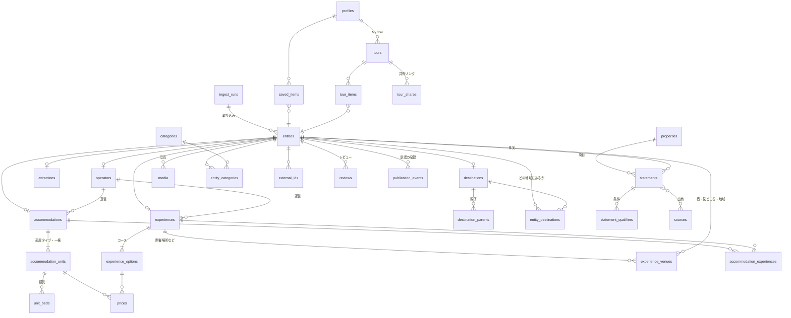

目的：WANDRARA に必要なデータモデルをすべて書き出し、表を作る前に言葉・関係・列を決める。データ構造はこのサービスの中心なので、migration はこの資料が決まってから書く。

# WANDRARA データモデル

状態：案（2026-11-15）。概念と論理（表・主な列・関係）まで。型・索引・RLS は次の段階で詰める。

## 1. 前提

### ビジネスモデル（PRD より）
- 写真から、地域・宿・体験を見つけるディスカバリーのサービス。予約や販売はしない（ベータ）
- 見つけ方は 2 方向：地域 → そこでできる体験、体験 → それができる地域
- 差別化は「細かく、出典があり、新しい事実」。不明は不明と出し、レビューは誰かの意見として出す
- 最初に厚くするのは宿、次に体験
- 後で：AI が作るパッケージ、地域の物産やパートナー商品の販売、現地取材

### 設計の原則
1. **ビジネスの言葉で表を分ける**。「spot」のような何でも入る言葉は使わない
2. **宿と体験は同列**。どちらも「本体 → 単位 → 料金」の同じ形で、どちらかがもう一方の下にぶら下がらない
3. **共通の仕組みは共通の ID に付ける**。事実・写真・カテゴリ・外部 ID・保存・My Tour は、宿・体験・見どころ・地域に同じ形で付く
4. **事実は値と出典を一緒に持つ**（Wikidata の statement の形）。項目は定義表で型を決め、自由な文字列のキーにしない
5. **不明と「無い」を分ける**。値が無いことと、無いと確かめたことは別
6. **言語は増える**。名前・説明は元の表に持たず、翻訳の表に持つ
7. **外部の標準に対応づける**。分類や設備は自前のコードを正とし、観光庁・OTA・Google・OSM などへの対応表を持つ
8. **公開は承認で決める**。投入は下書きで入り、承認で公開になる

## 2. 全体図

## 3. 用語

| 言葉 | 表 | 意味 | 例 |
|---|---|---|---|
| 地域 | destinations | 観光地としての地域。親子の階層を持ち、親は複数でもよい | 箱根、仙石原、伊豆、伊東 |
| 見どころ | attractions | 行って見る・歩く対象。それ自体は宿でも体験でもない | 城ヶ崎海岸、大涌谷、仙石原高原 |
| 宿 | accommodations | 泊まれる施設 | ヴィラ キング 熱海、旅館、ホテル |
| 宿の単位 | accommodation_units | 料金と定員の単位。部屋タイプ、または一棟貸しの一棟 | 和室 10 畳、一棟（最大 10 名） |
| 体験 | experiences | すること。時間を使い、多くは料金がかかる | ワイナリー見学、磯遊び、BBQ |
| 体験のコース | experience_options | 料金と所要時間の単位 | 90 分コース、試飲つきコース |
| 運営者 | operators | 宿や体験を運営する事業者 | 株式会社〇〇 |
| 事実 | statements | ある対象についての、出典つきの 1 つの主張 | 「駐車場：あり（3 台）」出典 公式サイト、確認日 |
| 項目 | properties | 事実の項目の定義（型・単位・付けられる対象） | parking_spaces（整数、台） |
| 出典 | sources | 事実の根拠 | 公式サイトの URL、取得日 |
| 写真 | media | 権利情報つきの画像 | |
| カテゴリ | categories | 自前の分類。階層を持ち、多対多で付く | 温泉 ＞ 貸切風呂 |
| 共通の ID | entities | 宿・体験・見どころ・地域・運営者に共通の ID と公開状態 | |

## 4. モデル一覧

区分：**β** ベータで使う／**後** 後で足す（表の形だけ決めておく）

### 4.1 共通の ID と公開

**entities**（β）：宿・体験・見どころ・地域・運営者の共通の ID。各表は同じ id を主キーにして 1 対 1 で参照する
- id、type（destination / attraction / accommodation / experience / operator）
- slug（URL 用）、publish_status（draft / published / withdrawn）
- is_demo（デモ表示）、editorial_rank（編集部のおすすめ順。人気の代わりにしない）
- ingest_run_id（最後に取り込んだ回）、created_at、updated_at

**publication_events**（β）：公開状態の変更の記録
- entity_id、from_status、to_status、actor（API キー or 人）、reason、at

### 4.2 地域と見どころ

**destinations**（β）：地域
- id（= entities.id）、level（region / municipality / district / area）
- geo（代表地点。後で範囲の形も）、geo_source
- municipality_code（全国地方公共団体コード 6 桁。市町村のときだけ）

**destination_parents**（β）：地域の親子。木ではなく DAG（観光エリアは行政区画と重なる）
- child_id、parent_id、kind（administrative / tourism）

**attractions**（β）：見どころ
- id、attraction_type（自前の列挙。nature / onsen_town / shrine_temple / museum / viewpoint / beach など）
- geo、address、opening_hours（事実でもよい。下の注）

**entity_destinations**（β）：宿・体験・見どころがどの地域にあるか
- entity_id、destination_id、role（located_in / serves）

### 4.3 運営者

**operators**（β）：運営する事業者
- id、legal_name、kind（company / individual / municipality / association）
- website、license_numbers（旅館業許可・住宅宿泊事業の届出番号など。事実でもよい）

### 4.4 宿

**accommodations**（β）
- id、operator_id
- accommodation_type（自前の列挙：hotel / ryokan / vacation_rental / minshuku / pension / hostel / glamping / campground）
- geo、address、check_in_from、check_in_until、check_out_until
- official_url

**accommodation_units**（β）：部屋タイプ、または一棟
- id、accommodation_id、unit_type（room_type / whole_property / bed_in_dorm / site）
- max_occupancy、floor_area_m2、tatami_mats（畳数）、bedrooms、bathrooms、toilets
- room_style（japanese / western / japanese_western）、view

**unit_beds**（β）：寝具
- unit_id、bed_type（single / semi_double / double / queen / king / futon / sofa_bed / bunk）、count

### 4.5 体験

**experiences**（β）
- id、operator_id
- experience_type（自前の列挙。カテゴリとは別に「形」を表す：tour / workshop / tasting / activity / facility_use / event）
- duration_min_from、duration_min_to（OCTO と同じ。分）
- booking_required（要予約か）、official_url

**experience_options**（β）：コース。1 つだけなら default を 1 行置く
- id、experience_id、is_default
- duration_min_from、duration_min_to、min_participants、max_participants、min_age
- languages（案内の言語）

### 4.6 つながり

**experience_venues**（β）：体験がどこで行われるか
- experience_id、venue_entity_id（宿・見どころ・地域）
- role（held_at / meeting_point / start / end / admission_included / related）

**accommodation_experiences**（β）：宿と体験の対等な関係
- accommodation_id、experience_id
- relation（on_site＝宿の中でできる / offered_by_property＝宿が手配する / partner＝提携先）

### 4.7 料金

**prices**（β）：料金の観測。宿の単位か体験のコースのどちらか一方に付く
- id、accommodation_unit_id か experience_option_id（どちらか一方だけ）
- amount、amount_max（幅があるとき）、currency（ISO 4217）、is_from（「〜から」の目安）
- basis（per_person / per_unit / per_group / per_booking）、period（per_night / per_stay / per_session）
- guests（何名利用時か）、nights、meal_plan（room_only / breakfast / half_board＝1 泊 2 食 / full_board）
- valid_from、valid_to、applies_to（曜日・季節などの条件）
- tax_included、service_charge_included、bathing_tax_included（入湯税）、accommodation_tax_included（宿泊税）、cleaning_fee_included：それぞれ included / excluded / not_applicable / unknown
- fees_note、checked_at、出典（statement と同じ sources に結ぶ）

### 4.8 事実（statement）

**properties**（β）：項目の定義
- code（例 parking_spaces、private_onsen、bbq_allowed、wifi、quiet_hours）
- datatype（boolean / integer / decimal / text / enum / time_range / url）
- unit（台、Mbps、分 など）、applies_to（どの種類の対象・単位に付けられるか）
- group（設備 / 規則 / アクセス / 制限 など。画面のまとまり）
- 名前と説明は翻訳の表に持つ

**property_options**（β）：enum の選択肢
- property_code、code、sort

**property_mappings**（β）：外部の標準への対応
- property_code、scheme（ota_hac / ota_rma / google_lodging / google_vr / schema_org / osm / mlit_dataset）、external_code

**statements**（β）：事実
- id、entity_id（unit やコースに付くときは対象の id も：subject_unit_id / subject_option_id）
- property_code
- value_kind（value / unknown / none）：none は「無いと確かめた」
- value（datatype に合わせて保存）
- rank（preferred / normal / deprecated）：食い違いは行を並べ、正とするものを preferred にする
- status（unverified / verified / conflict / stale）
- valid_from、valid_to（季節限定など）、checked_at、checked_by

**statement_qualifiers**（β）：条件
- statement_id、qualifier（season / weekday / fee_required / reservation_required / note）、value

**sources**（β）：出典
- id、source_type（official_site / ota / government / onsite_research / phone / document）
- url、publisher、retrieved_at、archive_url

**statement_sources**（β）：事実と出典の多対多
- statement_id、source_id、quote（根拠の抜き出し）

### 4.9 写真

**media**（β）
- id、entity_id、subject_unit_id / subject_option_id（任意。どの部屋の写真か）
- storage_key（置き場所に依存しないキー）、width、height、sort、is_hero
- license（SPDX か URL）、creator、credit_text、copyright_holder、acquire_license_url
- source_page_url、original_url、retrieved_at、rights_checked_at
- digital_source_type（撮影 / AI 生成 など。IPTC と同じ考え方）、is_demo
- 代替テキストは翻訳の表に持つ

### 4.10 カテゴリ

**categories**（β）：自前の分類。宿にも体験にも見どころにも同じ分類を使う
- id、icon、sort

**category_parents**（β）：階層（親は複数でもよい）
- child_id、parent_id

**entity_categories**（β）：多対多
- entity_id、category_id、is_primary

**category_mappings**（β）：外部の分類への対応
- category_id、scheme（mlit_kanko_5digit / gif_poi / osm_tag / google_ttd / schema_org）、external_code

### 4.11 外部 ID

**external_ids**（β）
- entity_id、scheme（google_place / osm_node / osm_way / osm_relation / wikidata / municipality_code / rakuten_travel / jalan / booking / airbnb / collector）、value、url
- (scheme, value) は一意

### 4.12 多言語

**languages**（β）：BCP 47 のコード、表示名、有効か、フォールバック先、並び順

**〈表〉_translations**（β）：名前・説明・代替テキストなど、言語ごとに変わる文字列
- 対象の id、language、各文字列の列
- origin（source / machine / human）、model、source_language、source_hash、translated_at
- 対象：destinations / attractions / accommodations / accommodation_units / experiences / experience_options / operators / categories / properties / property_options / media

### 4.13 レビュー

**reviews**（β・読み取りのみ）：外部のレビューの抜き出し。投稿はしない
- id、entity_id、source_id（どこからの抜き出しか）、author_display、language、posted_at
- excerpt、original_url、rights_checked_at
- 数や平均点は作らない。元の点数があるときだけ rating と scale を持つ

### 4.14 通貨と為替

**currencies**（β）：ISO 4217、表示名、小数の桁

**fx_rates**（β）：参考の為替
- base、quote、rate、as_of、source（例 Frankfurter）。無ければ換算を出さない

### 4.15 利用者

**profiles**（β）：auth.users と 1 対 1
- user_id、display_name、preferred_language、preferred_currency

**saved_items**（β）：保存
- user_id、entity_id、saved_at

**tours**（β）：My Tour
- id、user_id、name、created_at、updated_at

**tour_items**（β）：My Tour に入れたもの（宿・体験・見どころが混ざる）
- tour_id、entity_id、position、note

**tour_shares**（β）：閲覧だけの共有リンク
- tour_id、token、created_at、revoked_at

### 4.16 取り込みと承認

**collector_keys**（β）：エージェント用の API キー
- id、name、key_hash、created_at、revoked_at、last_used_at

**ingest_runs**（β）：取り込みの 1 回
- id、collector_key_id、bundle_hash、dry_run、started_at、finished_at、summary

**ingest_records**（β）：bundle の原本（今の import_records）
- external_ref、entity_id、ingest_run_id、record（JSON の原本）、collected_at

### 4.17 検索

**search_documents**（β）：検索用にまとめた文と埋め込み
- entity_id、language、text、embedding、updated_at

### 4.18 後で足すもの（形だけ決める）
- **packages / package_items**：AI や編集部が組んだ旅程の商品（宿・体験・見どころの並び）
- **rate_plans**：宿の「プラン」（食事・特典の組み合わせ）。prices は rate_plan にも付けられるようにする
- **availability / bookings**：空き・予約。予約を始めるとき
- **products / offers**：物産・パートナー商品の販売
- **field_research_assignments**：現地取材の依頼と結果（結果は statements と media に入る）

## 5. 品質のルール
- 公開できるのは、publish_status = published で、写真の権利と必須の項目を確かめたものだけ
- 画面に出す事実は、rank が preferred（無ければ normal）で、status が conflict でないもの。conflict は「情報が食い違っています」と出す
- 値が無いときは「情報なし」、value_kind = none は「無し（確認済み）」と出し分ける
- 料金は、通貨・単位・人数・税や料金の込み別を持たないものを出さない
- レビューの数や点数を作らない。デモの内容は is_demo で必ず示す
- 為替は保存した値だけを使い、日時と出どころを出す。無ければ換算しない

## 6. 標準との対応

| WANDRARA | schema.org | 体験の標準（OCTO / Google Things to do） | 宿の標準（観光庁 標準データセット / OTA / Google Lodging） | その他 |
|---|---|---|---|---|
| destinations | TouristDestination, AdministrativeArea | Google: related_locations | | 全国地方公共団体コード, Wikidata |
| attractions | TouristAttraction | OCTO: POINT_OF_INTEREST | | 観光庁 観光入込客統計の地点分類, OSM tourism=* |
| accommodations | LodgingBusiness（Hotel, VacationRental …） | | 標準データセット 施設, OTA HotelDescriptiveContent, Google Property | OTA PCT コード |
| accommodation_units | Accommodation（HotelRoom, Suite, House） | | 標準データセット 客室, Google GuestUnitType / LivingArea, Expedia Room | |
| unit_beds | BedDetails | | OTA BED コード | |
| experiences | TouristTrip, Event | OCTO Product, Google Product | | |
| experience_options | Offer | OCTO Option, Google Option | | |
| operators | Organization, LocalBusiness | OCTO Supplier, Google Operator | | |
| prices | Offer, UnitPriceSpecification | OCTO pricing, Google PriceOption | 標準データセット 料金（CHG, MPT） | Viator pricingInfo |
| experience_venues | itinerary, location | OCTO locations.types, Google RelatedLocation.relation_type | | |
| statements / sources | PropertyValue, citation | | | Wikidata statement, W3C PROV-O |
| properties / property_mappings | amenityFeature | OCTO features | OTA HAC / RMA, Google Lodging の項目 | |
| media | ImageObject | | | IPTC Photo Metadata |
| categories / category_mappings | | Google の 29 カテゴリ | | 観光庁 5 桁分類, GIF POI コード, OSM |

## 7. 今の表との対応

| 今 | 新しい表 |
|---|---|
| spots（kind = stay） | entities + accommodations + accommodation_units（一棟なら 1 行） |
| spots（kind = experience） | entities + experiences + experience_options（default 1 行） |
| spots（kind = place） | entities + attractions |
| areas | entities + destinations + destination_parents |
| spot_categories | entity_categories |
| categories（mode 列） | categories + category_parents（mode はやめ、宿・体験・見どころで同じ分類を使う） |
| spot_facts | properties + statements + statement_sources + sources |
| spot_prices | prices |
| spot_photos | media |
| import_records | ingest_records + ingest_runs |
| spots.external_ref | external_ids（scheme = collector） |
| name / summary（{ja,en} の JSON） | 〈表〉_translations |

## 8. 決めること
1. 共通の ID の表の名前（今は entities）
2. destinations と attractions の名前でよいか
3. 見どころの営業時間・料金を列で持つか、事実（statements）で持つか
4. 運営者をベータで入れるか（今のデータには運営者の情報が少ない）
5. 料金の出典を statements と同じ sources に結ぶか、prices に直接持つか
6. 検索（search_documents）をベータで作るか
