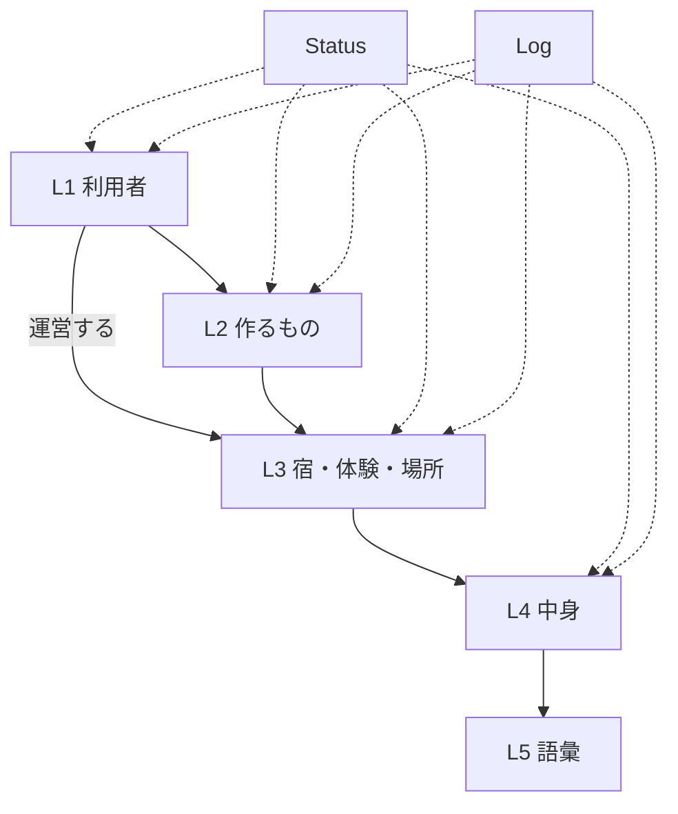

目的：WANDRARA に必要なデータモデルを層に分けて書き出し、表を作る前に決める。データ構造はこのサービスの中心なので、migration はこの資料が決まってから書く。

# WANDRARA データモデル

状態：案（2026-11-15）。層・DataClass・主なフィールドと、処理の Input → Output まで。型・索引・RLS は次の段階で詰める。

## 1. 前提

### ビジネスモデル（PRD より）
- 写真から、宿・体験・場所を見つけるディスカバリーのサービス。予約や販売はしない（ベータ）
- 見つけ方は 2 方向：場所 → そこでできる体験、体験 → それができる場所
- 差別化は「細かく、出典があり、新しい事実」。不明は不明と出し、レビューは誰かの意見として出す
- 利用者は旅行者だけでなく、宿や体験の運営者、データを集めるエージェントもいる
- 後で：AI が作るパッケージ、物産やパートナー商品の販売、現地取材

### 原則
1. **層で分ける**。上の層は下の層を参照してよいが、下の層は上の層を参照しない
2. **Status は独立させる**。どの層のものも指せるが、どの層からも参照されない
3. **処理は矢印で書く**。DataClass は自分を作った処理を持たない。処理が残す記録は Log に置く
4. **ビジネスの言葉を使う**。「spot」のような何でも入る言葉は使わない
5. **宿・体験・場所は同列**（L3）。宿と体験は「本体 → 単位 → 料金」の同じ形
6. **事実は値と出典を一緒に持つ**（Wikidata の statement の形）。項目は L5 の Property で型を決める
7. **不明と「無い」を分ける**
8. **言語は増える**。名前・説明は本体に持たず、Text（言語ごと）に持つ
9. **外部の標準に対応づける**。自前のコードを正とし、観光庁・OTA・Google・OSM などへの対応を L5 に持つ

## 2. 層

```
L1 利用者       User（旅行者 / 運営者 / エージェント / 編集者）
L2 作るもの     Tour・TourItem・SavedItem・TourShare・Curation（編集部のおすすめ）
L3 提供されるもの Accommodation ・ Experience ・ Location（同列）
L4 中身         Unit・Option・Price・Media・Fact・Text・Review・Tag・ExternalId
L5 語彙         Category・Property・Source・Language・Currency・FxRate

Status          公開・確認などの状態（独立）
Log             処理が残す記録（取り込み・翻訳・状態の変更）
```

参照の向き：L1 → L2 → L3 → L4 → L5。Status と Log は各層を指すが、各層からは指されない。



区分：**β** ベータで使う／**後** 後で足す（形だけ決める）

## 3. L1 利用者

**User**（β）：アカウント（Supabase Auth の auth.users と 1 対 1）
- id、display_name、preferred_language、preferred_currency
- roles（traveler / operator / agent / editor。複数を持てる）

**OperatorProfile**（β）：運営者としての情報。User のうち operator だけが持つ
- user_id、legal_name、kind（company / individual / municipality / association）、website
- license_numbers（旅館業許可・住宅宿泊事業の届出番号など）

**Operates**（β）：運営者がどの宿・体験を運営するか（L1 → L3）
- user_id、subject_id（Accommodation か Experience）、role（owner / manager）

**AgentKey**（β）：エージェントの API キー
- id、user_id（agent）、name、key_hash、created_at、revoked_at、last_used_at

## 4. L2 作るもの

**Tour**（β）：My Tour。id、user_id、name、created_at、updated_at

**TourItem**（β）：tour_id、subject_id（宿・体験・場所が混ざる）、position、note

**SavedItem**（β）：user_id、subject_id、saved_at

**TourShare**（β）：閲覧だけの共有リンク。tour_id、token、created_at、revoked_at

**Curation**（β）：編集部のおすすめ順。user_id（editor）、subject_id、rank、updated_at。人気の数の代わりにしない

**Package / PackageItem**（後）：売る旅程。Tour と同じ形で、販売の条件を持つ

**UserReview**（後）：利用者が投稿するレビュー

## 5. L3 提供されるもの

**Subject**（β）：宿・体験・場所の共通の ID。L2 や L4 はここを指す
- id、type（accommodation / experience / location）、slug、is_demo

**Accommodation**（β）：宿
- id（= Subject.id）、accommodation_type（hotel / ryokan / vacation_rental / minshuku / pension / hostel / glamping / campground）
- geo、address、check_in_from、check_in_until、check_out_until、official_url

**Experience**（β）：体験
- id、experience_type（tour / workshop / tasting / activity / facility_use / event）
- duration_min_from、duration_min_to、booking_required、official_url

**Location**（β）：場所。地域（箱根、仙石原）も見どころ（仙石原高原、城ヶ崎海岸）も同じ形で、親子の階層を持つ
- id、location_type（region / municipality / district / area / attraction）
- geo、address、municipality_code（全国地方公共団体コード 6 桁。市町村のとき）

**LocationParent**（β）：場所の親子。親は複数でもよい（観光エリアは行政区画と重なる）
- child_id、parent_id、kind（administrative / tourism）

**Placement**（β）：宿・体験がどの場所にあるか、どこで行われるか
- subject_id（宿か体験）、location_id
- role（located_in / held_at / meeting_point / start / end / admission_included / related）

**AccommodationExperience**（β）：宿と体験の対等な関係
- accommodation_id、experience_id、relation（on_site / arranged_by_property / partner）

## 6. L4 中身

**Unit**（β）：宿の単位。部屋タイプか一棟
- id、accommodation_id、unit_type（room_type / whole_property / bed_in_dorm / site）
- max_occupancy、floor_area_m2、tatami_mats、bedrooms、bathrooms、toilets、room_style（japanese / western / japanese_western）、view

**UnitBed**（β）：unit_id、bed_type（single / semi_double / double / queen / king / futon / sofa_bed / bunk）、count

**Option**（β）：体験のコース。1 つだけなら default を 1 つ置く
- id、experience_id、is_default、duration_min_from、duration_min_to
- min_participants、max_participants、min_age、languages

**Price**（β）：料金の観測。Unit か Option のどちらか一方に付く
- id、unit_id か option_id
- amount、amount_max、currency、is_from（「〜から」の目安）
- basis（per_person / per_unit / per_group / per_booking）、period（per_night / per_stay / per_session）
- guests、nights、meal_plan（room_only / breakfast / half_board＝1 泊 2 食 / full_board）
- valid_from、valid_to、conditions（曜日・季節）
- tax / service_charge / bathing_tax（入湯税）/ accommodation_tax（宿泊税）/ cleaning_fee：included / excluded / not_applicable / unknown
- checked_at、source_ids

**Fact**（β）：事実
- id、subject_id（Unit や Option に付くときは unit_id / option_id も）、property_code
- value_kind（value / unknown / none）：none は「無いと確かめた」
- value、valid_from、valid_to
- rank（preferred / normal / deprecated）：食い違いは行を並べ、正とするものを preferred にする

**FactQualifier**（β）：条件。fact_id、qualifier（season / weekday / fee_required / reservation_required / note）、value

**FactSource**（β）：fact_id、source_id、quote（根拠の抜き出し）

**Media**（β）：写真
- id、subject_id、unit_id / option_id（任意）
- storage_key、width、height、sort、is_hero
- license、creator、credit_text、copyright_holder、acquire_license_url
- source_page_url、original_url、retrieved_at、digital_source_type（撮影 / AI 生成など）

**Text**（β）：言語ごとの文字列。対象（Subject・Unit・Option・Media）ごと
- 対象の id、language、name、summary、description、alt
- origin（source / machine / human）：画面で「機械翻訳」と示すため

**Review**（β・読み取りのみ）：外部のレビューの抜き出し
- id、subject_id、source_id、author_display、language、posted_at、excerpt、original_url
- 元の点数があるときだけ rating と scale。数や平均を作らない

**Tag**（β）：Subject に Category を付ける。subject_id、category_id、is_primary

**ExternalId**（β）：subject_id、scheme（google_place / osm / wikidata / municipality_code / rakuten_travel / jalan / booking / airbnb / collector）、value、url。(scheme, value) は一意

## 7. L5 語彙

**Category**（β）：自前の分類。宿・体験・場所で同じ分類を使う。id、icon、sort
- **CategoryParent**：child_id、parent_id（親は複数でもよい）
- **CategoryMapping**：category_id、scheme（mlit_kanko_5digit / gif_poi / osm_tag / google_ttd / schema_org）、external_code

**Property**（β）：Fact の項目の定義
- code（parking_spaces、private_onsen、bbq_allowed、wifi、quiet_hours …）
- datatype（boolean / integer / decimal / text / enum / time_range / url）、unit、applies_to、group（設備 / 規則 / アクセス / 制限）
- **PropertyOption**：enum の選択肢
- **PropertyMapping**：scheme（ota_hac / ota_rma / google_lodging / google_vr / schema_org / osm / mlit_dataset）、external_code

**Source**（β）：出典。id、source_type（official_site / ota / government / onsite_research / phone / document）、url、publisher、retrieved_at、archive_url

**Language**（β）：BCP 47 のコード、表示名、有効か、フォールバック先、並び順

**Currency**（β）：ISO 4217、表示名、小数の桁

**FxRate**（β）：参考の為替。base、quote、rate、as_of、source

## 8. Status（独立）

**Status**（β）：ものの今の状態。1 つの対象・種類につき 1 行
- target_type、target_id、kind、value、updated_at
- kind と value：
  - publication：draft / published / withdrawn（対象：Subject）
  - verification：unverified / verified / conflict / stale（対象：Fact・Price・Media の権利）
  - translation：missing / machine / reviewed（対象：Text）

## 9. Log（処理が残す記録）

**IngestRun**（β）：取り込みの 1 回。id、agent_key_id、bundle_hash、dry_run、started_at、finished_at、summary

**IngestRecord**（β）：取り込んだ原本。ingest_run_id、external_ref、subject_id、record、collected_at

**StatusChange**（β）：Status の変更。target_type、target_id、kind、from、to、actor（User）、reason、at

**TranslationRun**（β）：機械翻訳。対象・言語・model・source_language・source_hash・translated_at

**SearchDocument**（β）：検索用にまとめた文と埋め込み（処理が作り直す派生データ）。subject_id、language、text、embedding、updated_at

## 10. 処理（矢印）

| 処理 | Input → Output |
|---|---|
| キーの発行 | User（agent）と名前 → **issueKey** → AgentKey と平文のキー（一度だけ） |
| 検証 | Bundle（未検証の JSON）→ **validateBundle** → 検証済みの Bundle ／ エラー |
| 計画 | Bundle と既存の Subject・Category → **planImport** → 取り込み計画 |
| 写真の配置 | 写真の中身 → **storeMedia** → storage_key と Media |
| 保存 | 取り込み計画 → **applyImport** → L3・L4、Status（publication = draft）、IngestRun・IngestRecord |
| 翻訳 | 原文の Text → **translate**（モデルは差し替え可）→ 訳の Text、Status（translation = machine）、TranslationRun。source_hash がずれたものだけ訳し直す |
| 確認 | Subject と L4 → **review** → 確認用のまとめ（事実・出典・写真・料金・不足） |
| 承認 | Subject と User → **approve** → Status（publication = published）と StatusChange。条件：有効な全言語の Text がそろい、写真の権利を確かめた |
| 取り下げ | Subject と User → **withdraw** → Status（publication = withdrawn）と StatusChange |
| 事実の表示 | Fact の集まりと Status → **resolveFacts** → 画面に出す値（rank が最上位、conflict は「食い違い」） |
| フィード | 公開中の L3 と Curation → **buildFeed**（並び順・主カード・関連の 3 戦略を差し替え可）→ フィード |
| 場所 → 体験 | Location → **findExperiences**（LocationParent・Placement・距離）→ Experience の一覧 |
| 体験 → 場所 | Experience か Category → **findLocations** → Location の一覧 |
| 検索の準備 | L3 と Text → **index** → SearchDocument |
| 検索 | 検索語 → **search**（全文と埋め込み。だめなら文字の一致）→ L3 の一覧 |
| 為替 | 外部の為替（Frankfurter）→ **fetchRates**（日次）→ FxRate |
| 換算 | Price・FxRate・表示通貨 → **convert** → 参考価格（為替の日時つき。無ければ換算しない） |
| 保存（利用者） | User と Subject → **save / unsave** → SavedItem |
| My Tour | User・名前・Subject の並び → **editTour** → Tour と TourItem |
| 共有 | Tour → **share** → TourShare → **openShared** → 閲覧だけの Tour |

## 11. 品質のルール
- 公開できるのは Status（publication）が published の Subject だけ
- 画面の事実は resolveFacts が決める。値が無いときは「情報なし」、none は「無し（確認済み）」
- 料金は、通貨・単位・人数・税や料金の込み別を持たないものを出さない
- レビューの数や点数を作らない。デモの内容は Subject.is_demo で必ず示す
- 為替は FxRate にある値だけを使う

## 12. 標準との対応

| DataClass | schema.org | 体験の標準（OCTO / Google Things to do） | 宿の標準（観光庁 標準データセット / OTA / Google Lodging） | その他 |
|---|---|---|---|---|
| User（operator）/ OperatorProfile | Organization, LocalBusiness | OCTO Supplier, Google Operator | | |
| Accommodation | LodgingBusiness（Hotel, VacationRental …） | | 標準データセット 施設, OTA HotelDescriptiveContent, Google Property | OTA PCT |
| Experience | TouristTrip, Event | OCTO Product, Google Product | | |
| Location | Place, TouristDestination, TouristAttraction, AdministrativeArea | OCTO POINT_OF_INTEREST, Google related_locations | | 全国地方公共団体コード, 観光庁 地点分類, OSM, Wikidata |
| Placement | location, itinerary | OCTO locations.types, Google RelatedLocation | | |
| Unit / UnitBed | Accommodation（HotelRoom, Suite, House）, BedDetails | | 標準データセット 客室, Google GuestUnitType / LivingArea, OTA BED | |
| Option | Offer | OCTO Option, Google Option | | |
| Price | Offer, UnitPriceSpecification | OCTO pricing, Google PriceOption | 標準データセット 料金（CHG, MPT） | Viator pricingInfo |
| Fact / Source | PropertyValue, citation | OCTO features | OTA HAC / RMA, Google Lodging | Wikidata statement, W3C PROV-O |
| Media | ImageObject | | | IPTC Photo Metadata |
| Category | | Google の 29 カテゴリ | | 観光庁 5 桁分類, GIF POI, OSM |
| Tour | Trip, ItemList | | | |

## 13. 今の表との対応

| 今 | 新しい DataClass |
|---|---|
| spots（kind = stay） | Subject + Accommodation + Unit（一棟なら 1 つ） |
| spots（kind = experience） | Subject + Experience + Option（default 1 つ） |
| spots（kind = place） | Subject + Location（location_type = attraction） |
| areas | Subject + Location + LocationParent |
| spots.area_id | Placement（located_in） |
| spots.publish_status | Status（publication） |
| spots.editorial_rank | Curation |
| spots.external_ref | ExternalId（scheme = collector） |
| categories（mode 列） | Category + CategoryParent（mode はやめる） |
| spot_categories | Tag |
| spot_facts | Property + Fact + FactSource + Source + Status（verification） |
| spot_prices | Price |
| spot_photos | Media |
| import_records | IngestRun + IngestRecord |
| name / summary（{ja,en} の JSON） | Text |

## 14. 決めること
1. L3 の共通の ID の名前（今は Subject）
2. Location に地域と見どころをまとめてよいか
3. Status に Fact の確認状態まで入れてよいか（画面で信頼度として出すので、読むたびに結合が要る）
4. 運営者のアカウントをベータで作るか（今は OperatorProfile だけ先に持つこともできる）
5. SearchDocument をベータで作るか
