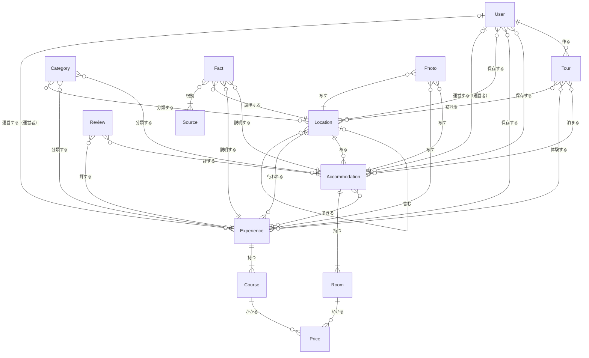

目的：WANDRARA のビジネスモデルを、登場するものとその関係だけで表す。表やフィールドはこの関係が決まってから作る。

# WANDRARA ビジネスモデルの関係

状態：案（2026-11-15）

## 関係図

## 登場するもの

| もの | 意味 |
|---|---|
| User | 使う人。旅行者として保存や Tour を作り、運営者なら宿や体験を運営する |
| Tour | User が作る旅の計画。宿・体験・場所を順に並べ、閲覧だけのリンクで共有できる |
| Accommodation | 宿 |
| Room | 宿で泊まる単位。部屋タイプ、または一棟貸しの一棟 |
| Experience | 体験 |
| Course | 体験を申し込む単位。時間や内容の違い |
| Location | 場所。地域（箱根、仙石原）も見どころ（大涌谷、城ヶ崎海岸）も含み、場所が場所を含む |
| Price | Room や Course にかかる料金 |
| Category | 宿・体験・場所の分類。分類は親子を持つ |
| Fact | 宿・体験・場所についての、確かめられる事実（駐車場がある、BBQ ができる など） |
| Source | Fact の根拠（公式サイト、現地取材 など） |
| Photo | 宿・体験・場所の写真 |
| Review | 宿や体験についての、誰かの意見 |

## 関係

| 関係 | 意味 |
|---|---|
| User が Tour を作る | 1 人が複数の Tour を持つ |
| User が宿・体験・場所を保存する | 保存したものだけを一覧にできる |
| User（運営者）が宿・体験を運営する | 運営者でない User もいる |
| Tour が宿・体験・場所を含む | 順番があり、宿・体験・場所が混ざる |
| 場所が場所を含む | 伊豆 ⊃ 伊東 ⊃ 城ヶ崎海岸。1 つの場所が複数の場所に含まれてもよい |
| 宿は場所にある／体験は場所で行われる | 場所から宿・体験を、宿・体験から場所を見つける |
| 宿で体験ができる | 宿と体験は同列で、どちらかがもう一方に属さない |
| 宿は Room を、体験は Course を持つ | 料金はその単位にかかる |
| Category が宿・体験・場所を分類する | 1 つのものに複数の分類が付く |
| Fact が宿・体験・場所を説明し、Source が根拠になる | 根拠の無い事実は出さない |
| Photo が宿・体験・場所を写す | |
| Review が宿・体験を評する | 意見であって事実ではない |
